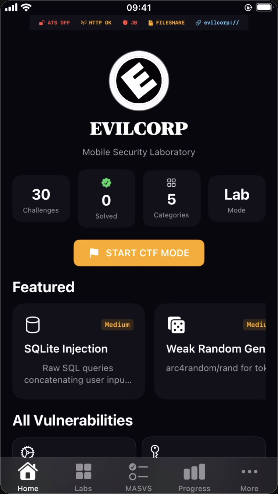
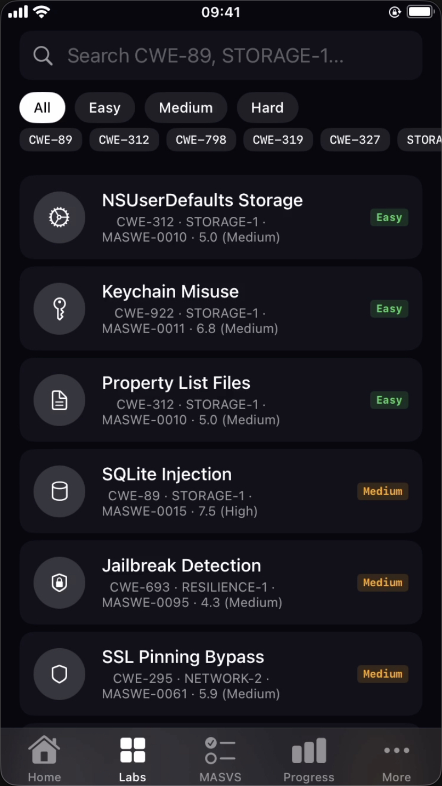
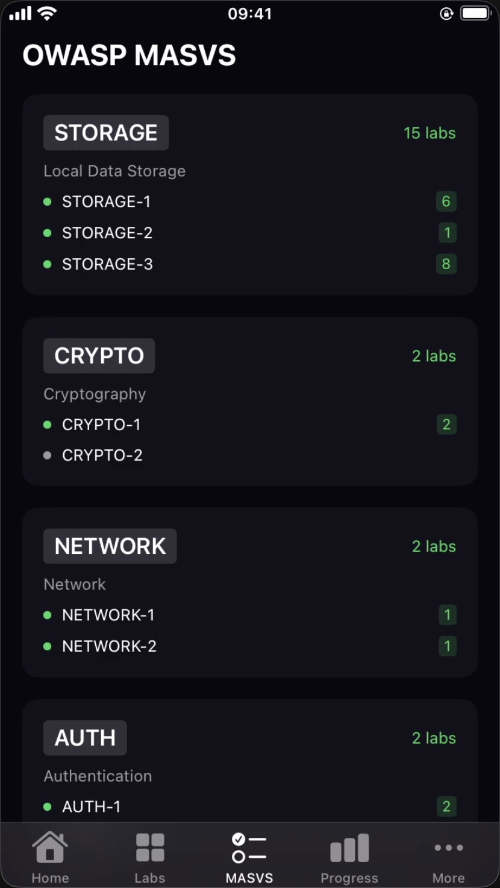
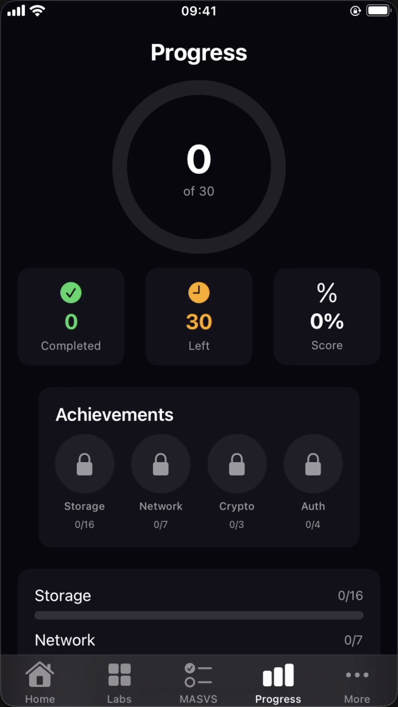
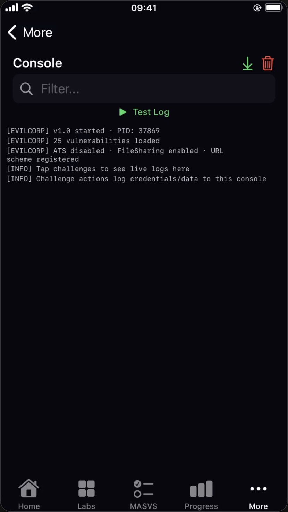

<div align="center">

# EvilCorp iOS

**An intentionally vulnerable SwiftUI laboratory for structured iOS security training**

[](https://github.com/jankesec/evilcorp-ios/actions/workflows/ci.yml)
[](https://swift.org/)
[](https://developer.apple.com/ios/)
[](#challenge-catalog)
[](LICENSE)

Thirty self-contained labs mapped to CWE, OWASP MASVS, and MASWE, with progressive
hints, CTF scoring, local progress tracking, and per-challenge Frida examples.

</div>

> [!CAUTION]
> EvilCorp is deliberately insecure. Run it only on a dedicated simulator or disposable
> test device. Do not use personal credentials, personal data, production accounts, or a
> device you rely on.

## What this project is

EvilCorp is a mobile security training application. Each challenge isolates a recognizable
insecure pattern and connects the hands-on exercise to industry taxonomy. It is designed for:

- iOS application-security workshops;
- OWASP MASVS and MASWE study;
- static and dynamic analysis practice;
- Frida, LLDB, proxy, and filesystem inspection labs;
- repeatable CTF exercises with synthetic data.

It is not a production security reference, a stealth implant, or evidence that a technique
works against every iOS release. Several APIs are intentionally weak or deprecated because
the insecure behavior itself is the subject of the lab.

## Interface

<div align="center">
  
  
  
  
  
</div>

The interface uses a restrained black-and-white system with semantic colors for difficulty,
completion, and deliberately insecure states. Screenshots are stored in this repository;
the README does not depend on an external image host.

## Product structure

```text
                         EvilCorp iOS
                              │
          ┌───────────────────┼───────────────────┐
          │                   │                   │
     Learn & browse      Run a local lab     Measure progress
          │                   │                   │
   Search · MASVS       Demo · Hints ·       CTF score · solved
   CWE · MASWE          Frida example        labs · achievements
          └───────────────────┼───────────────────┘
                              │
                    30 catalogued challenges
```

Challenge metadata is centralized in `EvilCorpChallenge.all`. UI totals, CTF scoring,
onboarding copy, progress calculations, and tests derive from that catalog instead of
duplicating hard-coded counts.

## Quick start

### Requirements

- macOS with Xcode 16 or newer;
- iOS 16 or newer simulator/device target;
- [XcodeGen](https://github.com/yonaskolb/XcodeGen) for regenerating the project.

### Build in Xcode

```bash
git clone https://github.com/jankesec/evilcorp-ios.git
cd evilcorp-ios
brew install xcodegen
make project
open EvilCorp.xcodeproj
```

Choose the `EvilCorp` scheme and an available simulator. The generated project is committed
for convenience; `project.yml` remains its source of truth.

### Verify from the command line

```bash
make check
```

This type-checks every Swift source and compiles both the app and unit-test bundle for a
generic iOS Simulator destination. To run tests on an installed simulator:

```bash
make test DESTINATION='platform=iOS Simulator,name=iPhone 16 Pro'
```

## Releases

GitHub releases include a source archive, SHA-256 manifest, and an unsigned IPA for
authorized lab use. The IPA is not ready for direct installation: sign it with your own
development identity and use only a dedicated test device. Release assets are reproducible
locally with:

```bash
make release-artifacts VERSION=v1.1.1
```

## Training workflow

1. Pick a challenge from Labs or the MASVS coverage view.
2. Reproduce the behavior with synthetic values.
3. Use progressive hints only when needed.
4. Inspect the Frida example and adapt it to your isolated lab.
5. Record the observation, affected control, and remediation—not only the flag.
6. Mark the challenge solved and review category coverage in Progress.

The snippets are teaching aids. They are not guaranteed to work unchanged across every
device, architecture, jailbreak, Frida version, or iOS release.

## Challenge catalog

| # | Challenge | Area | Difficulty | Mapping |
|---:|---|---|---|---|
| 1 | NSUserDefaults Storage | Storage | Easy | CWE-312 · STORAGE-1 · MASWE-0010 |
| 2 | Keychain Misuse | Storage | Easy | CWE-922 · STORAGE-1 · MASWE-0011 |
| 3 | Property List Files | Storage | Easy | CWE-312 · STORAGE-1 · MASWE-0010 |
| 4 | SQLite Injection | Storage | Medium | CWE-89 · STORAGE-1 · MASWE-0015 |
| 5 | Jailbreak Detection | Auth | Medium | CWE-693 · RESILIENCE-1 · MASWE-0095 |
| 6 | SSL Pinning Bypass | Network | Medium | CWE-295 · NETWORK-2 · MASWE-0061 |
| 7 | WebView XSS | Network | Medium | CWE-79 · PLATFORM-2 · MASWE-0057 |
| 8 | Insecure Logging | Storage | Easy | CWE-532 · STORAGE-3 · MASWE-0005 |
| 9 | Hardcoded Secrets | Storage | Medium | CWE-798 · STORAGE-1 · MASWE-0062 |
| 10 | Biometric Bypass | Auth | Hard | CWE-287 · AUTH-1 · MASWE-0025 |
| 11 | Broken Cryptography | Crypto | Medium | CWE-327 · CRYPTO-1 · MASWE-0048 |
| 12 | Insecure Network (HTTP) | Network | Medium | CWE-319 · NETWORK-1 · MASWE-0046 |
| 13 | URL Scheme Hijacking | Network | Medium | CWE-939 · PLATFORM-2 · MASWE-0056 |
| 14 | Screenshot Leakage | Storage | Easy | CWE-200 · STORAGE-3 · MASWE-0042 |
| 15 | Anti-Debugging Bypass | Auth | Hard | CWE-693 · RESILIENCE-4 · MASWE-0096 |
| 16 | Pasteboard Leakage | Storage | Easy | CWE-200 · STORAGE-3 · MASWE-0042 |
| 17 | iTunes File Sharing | Storage | Medium | CWE-200 · STORAGE-2 · MASWE-0010 |
| 18 | Keyboard Cache Leak | Storage | Easy | CWE-200 · STORAGE-3 · MASWE-0042 |
| 19 | Binary Patching | Crypto | Hard | CWE-1275 · RESILIENCE-4 · MASWE-0096 |
| 20 | Vulnerable Vault (PIN) | Auth | Hard | CWE-307 · AUTH-1 · MASWE-0025 |
| 21 | NSURLSession Cache | Network | Medium | CWE-200 · STORAGE-3 · MASWE-0010 |
| 22 | Excessive Permissions | Storage | Medium | CWE-863 · PLATFORM-1 · MASWE-0098 |
| 23 | Phishing & UI Redressing | Network | Medium | CWE-1021 · PLATFORM-2 · MASWE-0099 |
| 24 | Memory Sensitive Data | Storage | Hard | CWE-316 · STORAGE-3 · MASWE-0043 |
| 25 | XPC/IPC Communication | Network | Hard | CWE-306 · PLATFORM-2 · MASWE-0056 |
| 26 | Local Data Storage | Storage | Easy | CWE-312 · STORAGE-1 · MASWE-0010 |
| 27 | Device Intelligence | Storage | Easy | CWE-200 · STORAGE-3 · MASWE-0042 |
| 28 | Weak Random Generation | Crypto | Medium | CWE-338 · CRYPTO-1 · MASWE-0048 |
| 29 | Path Traversal | Storage | Hard | CWE-22 · PLATFORM-2 · MASWE-0056 |
| 30 | Background Fetch Leak | Storage | Medium | CWE-312 · STORAGE-3 · MASWE-0010 |

Mappings are training metadata, not a formal compliance assessment. Confirm current OWASP
definitions before using them in an audit or report.

## Deliberately insecure configuration

The lab includes insecure settings and implementation choices such as:

- arbitrary HTTP loads through ATS configuration;
- file sharing enabled for the application container;
- an unvalidated custom URL scheme;
- weak Keychain accessibility;
- client-side authentication decisions;
- hard-coded synthetic secrets and unsafe local storage;
- excessive permission requests with explicit training descriptions.

These behaviors are intentional only inside the named lab. Contributions must not add real
credentials, undeclared collection, production endpoints, or activity outside the local
training boundary.

## Repository layout

```text
.
├── EvilCorp/                 SwiftUI application and challenge views
├── EvilCorpTests/            Catalog and scoring invariants
├── EvilCorp.xcodeproj/       Generated, ready-to-open Xcode project
├── screenshots/              Repository-owned product screenshots
├── project.yml               XcodeGen source of truth
├── Makefile                  Reproducible project, build, and test commands
├── CHANGELOG.md              User-visible project history
├── CONTRIBUTING.md           Contribution and lab-boundary guidance
├── SECURITY.md               Security reporting scope
└── .github/workflows/ci.yml  macOS/iOS Simulator verification
```

## Responsible use

Use EvilCorp only on systems you own or are explicitly authorized to test. A dedicated
simulator is the safest default. If a challenge requires a jailbroken device, use an isolated
test device without personal accounts or data and document the exact environment used.

## Contributing and security

Read [CONTRIBUTING.md](CONTRIBUTING.md) before changing challenge behavior. Repository-level
security issues outside the intentionally vulnerable scope should follow [SECURITY.md](SECURITY.md).

## License

MIT. See [LICENSE](LICENSE).
